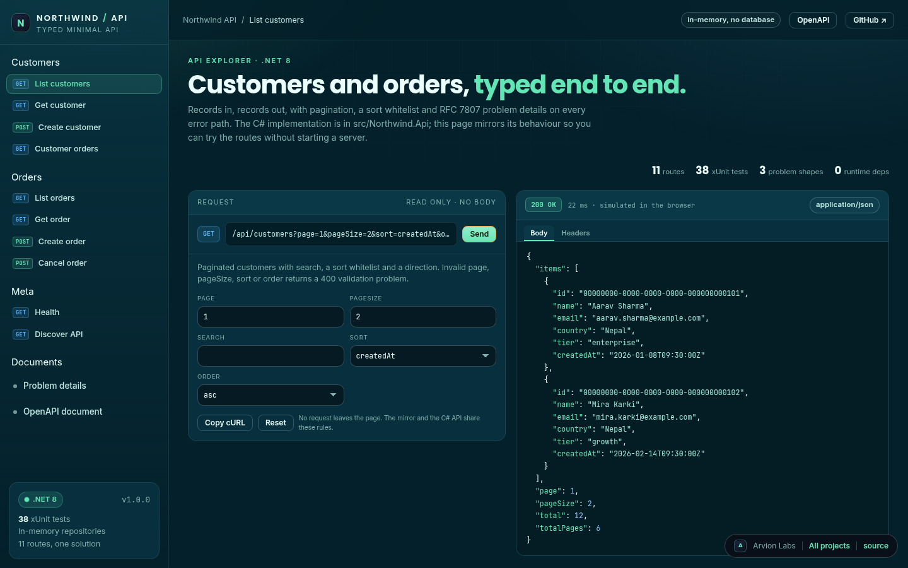
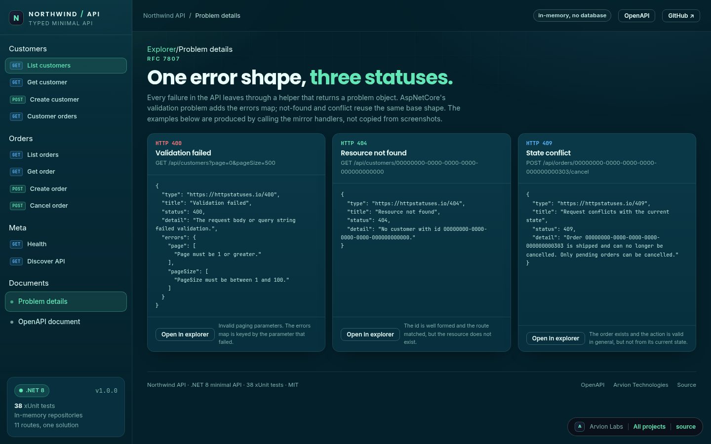

<div align="center">

</div>

<sub>Recorded from the live demo · <a href="docs/demo.mp4">MP4</a> · <a href="docs/screenshot.png">static frame</a></sub>

# Northwind API

A typed minimal API in C# on .NET 8, with xUnit tests, pagination, sorting,
validation and RFC 7807 problem details. The C# in `src/Northwind.Api` is the real
implementation. The static page in `demo/` is a browser mirror of the same rules,
built so the API can be explored without starting a server.

[**Open the live demo**](https://arvion-technology.github.io/labs/demos/northwind-api/) · [MIT](LICENSE)

---

Most minimal API samples stop at "hello world with a database". This one stays
small but finishes the parts that matter in review: typed request and response
records, a repository boundary, one error shape with a stable type, a validation
policy you can read in one file, deterministic seed data, and tests that call the
endpoint handlers directly. The OpenAPI document is hand-written JSON embedded in
the assembly, so the contract is diffable and adds no package.

The local machine used to build this repository has the .NET runtime but no SDK,
so `scripts/test.sh` runs `dotnet test` when an 8.x SDK is installed and otherwise
runs the same command in `mcr.microsoft.com/dotnet/sdk:8.0` with Docker.

## What it does

- **Customers** at `GET /api/customers`, with `page`, `pageSize`, `search`, a
  `sort` whitelist (`name`, `country`, `tier`, `createdAt`) and `order`.
  `GET /api/customers/{id}` returns one, `POST /api/customers` validates and
  creates, and `GET /api/customers/{id}/orders` returns that customer's orders.
- **Orders** at `GET /api/orders`, filterable by `customerId` and `status`, then
  paginated and sorted by `placedAt`, `total` or `status`. `GET /api/orders/{id}`
  returns one order with computed line totals, `POST /api/orders` validates the
  lines and creates a pending order, and `POST /api/orders/{id}/cancel` applies
  the one allowed cancellation transition.
- **Meta routes**: `GET /health`, a discovery document at `GET /api`, and the
  OpenAPI 3.0.3 document at `GET /openapi/v1.json`.
- **Validation** for names, email, country, tier, paging, sort, direction, order
  lines, quantities, prices and duplicate products. Errors are keyed by field,
  including indexes such as `lines[0].quantity`.
- **Problem details** on every error path: 400 validation, 404 not found, 409
  state conflict. Each has a `type`, `title`, `status`, `detail` and, for
  validation, an `errors` map.
- **38 xUnit tests** across validation, services, endpoint handlers and the
  OpenAPI document.

## Screenshots

| Explorer | Problem details |
| --- | --- |
|  |  |

## Architecture

```text
40-northwind-api/
├── Northwind.sln
├── src/Northwind.Api/
│   ├── Program.cs               route wiring, DI, singleton repositories
│   ├── Models/Records.cs        Customer, Order, OrderLine, OrderStatus
│   ├── Contracts/Responses.cs   typed request and response records, mappings
│   ├── Validation/RequestValidator.cs   all field and query rules
│   ├── Http/ApiProblem.cs       RFC 7807 helpers for 400, 404 and 409
│   ├── Repositories/            interfaces, in-memory stores, deterministic seed
│   ├── Services/                paging, sorting, customer and order operations
│   ├── Endpoints/               handler methods, mapped with MapGet/MapPost
│   ├── OpenApi/                 embedded document reader
│   └── openapi.json             the document itself
├── test/Northwind.Api.Tests/    xUnit: validation, services, handlers, OpenAPI
├── demo/                        static explorer, no dependencies
├── docs/                        screenshots and the recorded demo
└── scripts/test.sh              dotnet test, or Docker fallback
```

Dependencies point one way: endpoints call services, services call repository
interfaces, and the repository implementation is the only place that knows the
data lives in a list. Tests construct the same graph with no web host.

## Running it

With a .NET 8 SDK:

```bash
dotnet test Northwind.sln
dotnet run --project src/Northwind.Api
# then open http://localhost:5080/api/customers
```

With Docker only, which is how this repository was tested here:

```bash
docker run --rm -p 5080:8080 -v "$PWD":/app -w /app \
  -e ASPNETCORE_URLS=http://+:8080 \
  mcr.microsoft.com/dotnet/sdk:8.0 \
  dotnet run --project src/Northwind.Api
```

Ask it a few things:

```bash
curl "http://localhost:5080/api/customers?page=1&pageSize=5&sort=name"
curl "http://localhost:5080/api/orders?status=pending&sort=total"
curl -X POST http://localhost:5080/api/customers \
  -H "Content-Type: application/json" \
  -d '{"name":"Sita Gurung","email":"sita@example.com","country":"Nepal"}'
curl "http://localhost:5080/api/customers?page=0"
curl http://localhost:5080/openapi/v1.json
```

The browser explorer is served by the existing zero-dependency static server:

```bash
node scripts/serve.mjs . 4173
# then open http://localhost:4173/demo/
```

There is no `package.json`. `scripts/test.sh` is the single test entry point, and
the CI workflow uses `actions/setup-dotnet@v4` with `dotnet restore`, `dotnet
build` and `dotnet test`.

## How it works

**Typed records all the way through.** `CreateCustomerRequest` and
`CreateOrderRequest` are the only input shapes. They use nullable strings so the
validator can report a missing field instead of the binder throwing first. Domain
records (`Customer`, `Order`, `OrderLine`) are immutable; the cancel transition
uses `with` and writes a new order through the repository interface. Responses are
separate records, so a domain change cannot accidentally change the wire format.

**Validation is one file, with no HTTP knowledge.** `RequestValidator` returns a
`Dictionary<string, string[]>`. The endpoint maps that to a problem response, and
the tests exercise the validator on its own. Page and pageSize bounds, sort
whitelists, status parsing, email shape, country length, tier membership, order
line bounds and duplicate product detection all live there. The endpoint checks
the customer exists before creating an order, and the order service computes line
totals from quantity and unit price rather than trusting a client total.

**Paging and sorting are deterministic.** Each list endpoint filters first, then
applies a whitelisted sort, then breaks ties on id, then slices the page. That
last tie-break is what keeps page two stable when several rows share a timestamp.
`totalPages` is computed from the filtered count and is zero when the result is
empty.

**The repository is a boundary, not a detail.** Both repositories are interfaces
with the smallest useful surface: read, get by id, add and replace. The in-memory
implementation takes an optional seed so each test gets a clean, deterministic
store. Swapping in Entity Framework means one new implementation of two
interfaces, not a change to handlers.

**Errors share one helper.** `ApiProblem.Validation`, `ApiProblem.NotFound` and
`ApiProblem.Conflict` are the only places a failure is constructed. Validation
returns a ProblemDetails with an `errors` extension, and the tests assert the
status code, title, type and the errors map rather than a hand-rolled JSON string.

**The OpenAPI document is part of the source.** `openapi.json` lists nine path
entries, the query parameters, every response status and the schemas. It is an
embedded resource read by `OpenApiDocument`, served at `/openapi/v1.json`.
Because it is not generated at runtime, a route added without updating the
document is a review mistake the tests can catch: the document test names every
mapped route.

## Tests

```bash
bash scripts/test.sh
```

The script prints which path it took, local SDK or Docker. The suite is 38 xUnit
cases:

| Suite | Cases | What it covers |
| --- | --- | --- |
| `ValidationTests` | 9 | field rules, paging and query boundaries, order line bounds, duplicate products, status parsing, merged error maps |
| `ServiceTests` | 11 | paging and totals, search, sort order, order filters, line totals, cancel transitions, unknown ids, normalisation |
| `EndpointTests` | 14 | handler results for 200, 201, 400, 404 and 409, validation error keys, duplicate email, customer scoping, cancel guards |
| `OpenApiTests` | 4 | JSON validity, every route present, problem schemas, order filter parameters |

Handler tests call the endpoint methods directly (`CustomerEndpoints.List`,
`OrderEndpoints.Cancel`) and inspect typed results such as
`Ok<PagedResult<CustomerResponse>>` and `ProblemHttpResult`. No web host, port or
HTTP client is needed, which keeps the suite fast in Docker where the SDK image is
the slow part.

## Limitations

The repository is in memory and the API is unauthenticated, so every restart
resets the data and any caller can read or write every record. That is the one
thing to replace before this goes anywhere near production: a real store with
migrations, and authentication and authorisation in front of the routes.

## Project layout

```text
40-northwind-api/
├── Northwind.sln
├── src/Northwind.Api/           the API
│   ├── Models/ Contracts/ Validation/ Http/
│   ├── Repositories/ Services/ Endpoints/ OpenApi/
│   ├── openapi.json
│   └── Program.cs
├── test/Northwind.Api.Tests/    xUnit suites and shared fixtures
├── demo/                        explorer, mirror data, sample responses
│   ├── index.html, index.css, app.js
│   ├── arvion.css, arvion.js, fonts/
│   └── record.json              interaction script for the demo recording
├── docs/                        screenshots and demo.gif
├── scripts/                     test.sh, serve, shot, static checks
└── .github/workflows/ci.yml     setup-dotnet and dotnet test
```

## Credits

Built by [Arvion Technologies](https://arviontech.net) in Kathmandu. The API is a
teaching sample from our backend work: small enough to read in one sitting, with
the error contract and tests that we would expect on a client project. MIT
licensed.
